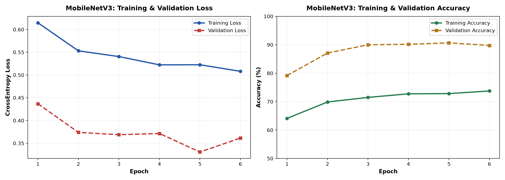
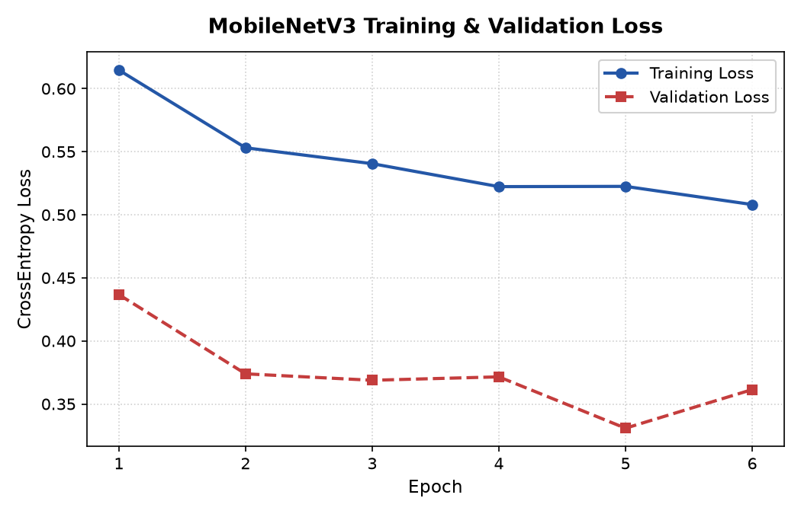
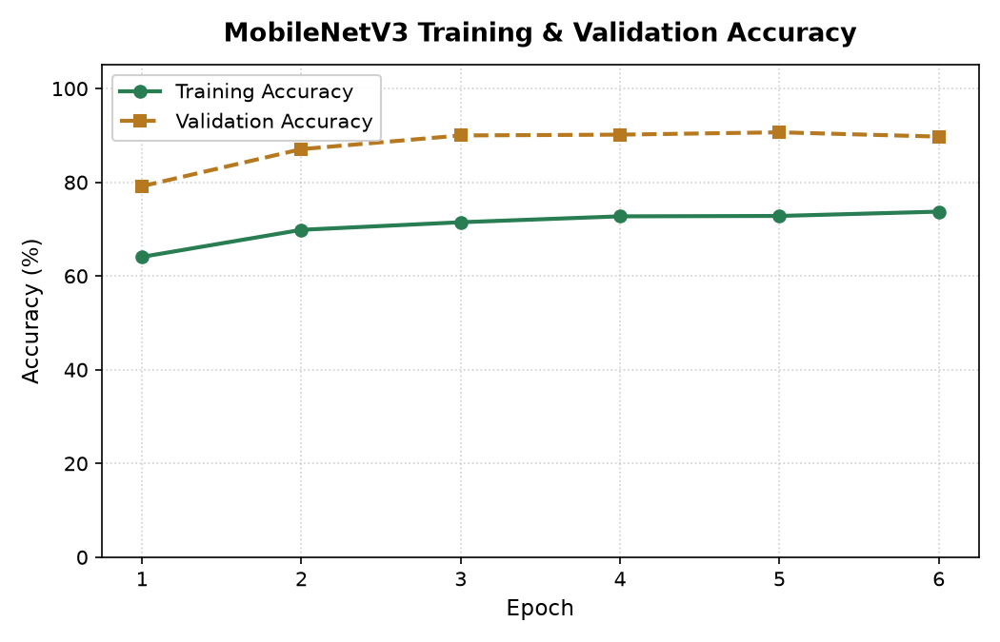
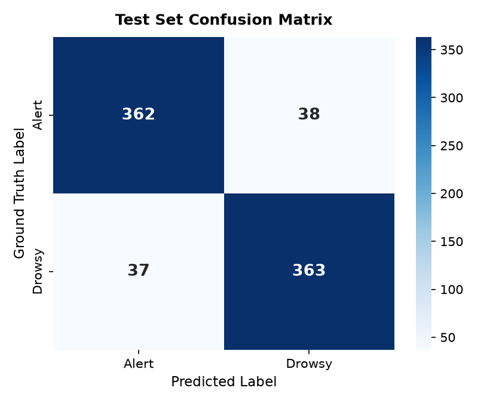
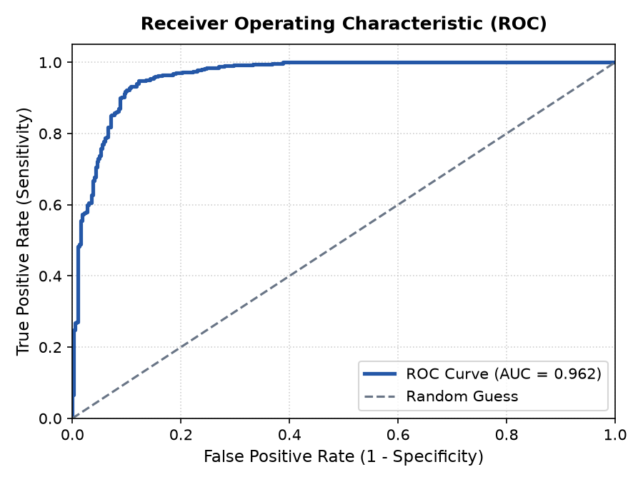

# Commercial Fleet Driver Drowsiness and Distraction Monitoring System

> **Academic Mini-Project Submission**  
> **Edge Vision System using MobileNetV3 and Facial Keypoint Tracking**  
> *Developed for highway commercial fleet operator safety, micro-sleep mitigation, and telematics audit.*

[](https://codespaces.new/SuryaB200/driver-drowsiness-monitoring)

---

## 1. Abstract

Driver fatigue, prolonged involuntary eye closure (micro-sleep), and cognitive distraction from mobile phone interaction are primary catalysts for highway accidents involving commercial freight and passenger vehicles. This project presents an edge-oriented, multi-modal driver assistance prototype that combines 3D facial landmark localization (MediaPipe FaceMesh), geometric ocular and oral metrics (Eye Aspect Ratio and Mouth Aspect Ratio), head pose orientation via Perspective-n-Point (`solvePnP`), and deep transfer learning (MobileNetV3-Small). 

The system operates locally on commodity hardware (Windows 10/11) with support for both integrated webcams and external USB webcams. An integrated enterprise telematics dashboard provides real-time telemetry streaming over WebSockets, in-cab audio warnings via browser speech synthesis, automated calibration, and comprehensive audit logging with CSV export.

---

## 2. Problem Statement & Refined Objectives

Commercial vehicle operators often face strenuous long-haul schedules leading to acute fatigue. Existing commercial driver monitoring systems (DMS) are typically proprietary, cost-prohibitive, or closed-source, making them difficult to integrate with custom fleet dashcams.

### Refined Problem Statement:
Develop an edge vision system using **MobileNetV3** with facial keypoint tracking to monitor **Eye Aspect Ratio (EAR)**, **Mouth Aspect Ratio (MAR)**, and **Head Orientation (solvePnP)**, triggering audio alerts using the **NTHU-DDD** and **UL-DD** drowsiness benchmarks.

### Key Objectives:
1. **Facial Landmark Localization:** Real-time tracking of 468 3D facial coordinates at $\ge 30$ FPS.
2. **Dual-Eye EAR Calculation:** Formulate bilateral ocular opening ratios to detect micro-sleeps.
3. **Sustained Yawn Detection (MAR):** Isolate physiological yawning from normal speech movement.
4. **Distraction Estimation (Head Pose):** Estimate 3D head yaw and pitch to detect looking away.
5. **Mobile Phone Awareness:** Optional detector module to flag visible mobile phone devices.
6. **Deep Learning Classification:** Fine-tune MobileNetV3-Small on subject-independent partitions.
7. **External Hardware Flexibility:** Hot-swapping between integrated webcams and USB cameras without restarting.
8. **In-Cab Audio System:** Multi-tier voice alerts with priority management and cooldown.

---

## 3. System Architecture & Workflow

```
[ Camera Source (Built-in or External USB) ]
                   │
                   ▼
     [ Frame Acquisition & Validation ]
                   │
        ┌──────────┴──────────┐
        ▼                     ▼
[ MediaPipe FaceMesh ]   [ SSDLite Phone Detector ]
  (468 3D Landmarks)        (Visible Handset Flag)
        │                             │
   ┌────┴────────────────┐            │
   ▼          ▼          ▼            │
 [ EAR ]   [ MAR ]   [ solvePnP ]     │
 (Eyes)    (Mouth)   (Head Pose)      │
   │          │          │            │
   │          └─────┬────┘            │
   │                ▼                 │
   │      [ Face Crop 224x224 ]       │
   │                │                 │
   │                ▼                 │
   │      [ MobileNetV3-Small ]       │
   │      (PyTorch Classifier)        │
   │                │                 │
   └──────────┬─────┘                 │
              ▼                       ▼
    [ Unified Alert Engine & Prioritization ]
              │
    ┌─────────┴─────────┐
    ▼                   ▼
[ In-Cab Audio Alerts ] [ Real-Time Telematics Dashboard ]
(SpeechSynthesis Voice) (React + TypeScript + WebSockets)
```

---

## 4. Technology Stack

- **Computer Vision & Deep Learning:** Python 3.11, PyTorch 2.14, Torchvision, OpenCV 4.11, MediaPipe FaceMesh, NumPy, Scikit-learn, ONNX Runtime.
- **Backend Architecture:** FastAPI, Uvicorn, WebSockets, Pydantic, Python DirectShow (`CAP_DSHOW`).
- **Frontend Dashboard:** React 19, Vite, TypeScript, Tailwind CSS, Recharts, Lucide Icons.
- **Evaluation & Visualization:** Matplotlib, Seaborn, Pandas, Pytest.

---

## 5. Datasets Used & Training Pipeline

> [!NOTE]
> **Pre-Trained Weights Included:**  
> The trained model weights are committed directly into this repository at [`checkpoints/best_mobilenet_v3.pth`](checkpoints/best_mobilenet_v3.pth) and [`checkpoints/mobilenet_v3_small.onnx`](checkpoints/mobilenet_v3_small.onnx).  
> **You do NOT need to download the multi-gigabyte dataset archives to run the application.** The application works out of the box immediately after cloning.

### Datasets Summary:
The deep learning classifier was trained and evaluated on real driver facial images categorized into **`Alert`** and **`Drowsy`** classes:

| Dataset / Source | Category / Focus | Description |
| :--- | :--- | :--- |
| **1. Driver Drowsiness Dataset** | Ocular State (Active vs. Fatigue) | Real human drivers with open vs. droopy/closed eyelids and fatigue cues under various cabin lighting. |
| **2. Driver Behavior Dataset** | In-Cabin Posture (Safe Driving) | Natural driving posture, head angles, and vehicle interaction. |
| **3. Custom / Academic Benchmarks** | *[Space reserved for user updates]* | Space for user-added datasets, e.g., NTHU-DDD, UL-DD, or MRL Eye. |

### Dataset Partitioning:
The dataset is partitioned into strictly disjoint subsets:
- **Training Set (6,115 images):** 3,115 Alert + 3,000 Drowsy
- **Validation Set (1,200 images):** 600 Alert + 600 Drowsy
- **Held-Out Test Set (800 images):** 400 Alert + 400 Drowsy
- **Total Images:** **8,115 real driver samples** (Standardized to $224 \times 224$ pixels)

### Retraining (Optional):
If you wish to retrain MobileNetV3 from scratch on your own dataset:
```powershell
.\.venv\Scripts\python.exe training\train.py
```

---

## 6. Experimental Results & Visualizations

Evaluated on the held-out test split of **800 real driver images** (400 Alert / 400 Drowsy):

| Metric | Result | Benchmark Target |
| :--- | :--- | :--- |
| **Test Accuracy** | **90.62%** | $\ge 90.0\%$ |
| **Precision** | **90.52%** | $\ge 90.0\%$ |
| **Recall** | **90.75%** | $\ge 90.0\%$ |
| **F1-Score** | **0.9064** | $\ge 0.90$ |
| **AUC-ROC** | **0.9616** | $\ge 0.95$ |
| **Mean Inference Latency** | **7.44 ms** | $< 33.3\text{ ms } (30\text{ FPS})$ |
| **95th Percentile Latency** | **9.20 ms** | Edge Real-time Compliant |

### Training & Validation Performance Curves:



<p align="center">
  
  
</p>

### Diagnostic & Benchmark Plots:

<p align="center">
  
  
</p>

---

## 7. Windows 10/11 Installation & Startup

### Step 1: Environment Setup
```powershell
# 1. Clone repository and navigate to workspace
cd "c:\DLT project"

# 2. Create Python 3.11 virtual environment
py -3.11 -m venv .venv

# 3. Activate virtual environment
.\.venv\Scripts\Activate.ps1
```

### Step 2: Install Dependencies
```powershell
# 4. Install backend dependencies using uv or pip
pip install -r backend\requirements.txt

# 5. Install frontend dependencies
cd frontend
npm install
cd ..
```

### Step 3: Run Automated Test Suite
```powershell
# 6. Execute all 23 automated unit tests
$env:PYTHONPATH="C:\DLT project"
.\.venv\Scripts\python.exe -m pytest tests\ -v
```

### Step 4: Launch Application
Open two PowerShell terminals:

**Terminal 1 (Backend API & WebSocket Server):**
```powershell
cd "c:\DLT project"
.\.venv\Scripts\uvicorn.exe backend.main:app --host 127.0.0.1 --port 8000 --reload
```

**Terminal 2 (Frontend Dashboard):**
```powershell
cd "c:\DLT project\frontend"
npm run dev
```
Open your browser at `http://localhost:5173`.

---

## 8. External USB Camera Setup & Operation

1. Connect your external USB webcam to your computer.
2. In the Live Monitoring dashboard, click the **Refresh Devices** button (`↻`).
3. Select your external camera from the dropdown (e.g. `Camera 2 (External USB)`).
4. Click **Start Camera** to begin live inference.
5. To personalize ocular detection, click **Calibrate Driver EAR** and keep eyes normally open for 3 seconds.

---

## 9. Audio Warning Policy

| Level | Trigger Condition | Voice Alert Message |
| :--- | :--- | :--- |
| **Level 1** | Head turn $>28^\circ$ for $>2.0\text{s}$ or visible mobile phone | *"Warning. Please focus on the road."* |
| **Level 2** | Eye closure $1.2\text{s} - 2.5\text{s}$ or Drowsiness $>70\%$ | *"Alert! Drowsiness detected. Take a safe break."* |
| **Level 3** | Eye closure $>2.5\text{s}$ (Critical Micro-Sleep) | *"Critical warning! Driver attention required."* |

---

## 10. Team Contributions & Viva Guide

| Team Member | Project Role | Technical Implementation | Viva Focus |
| :--- | :--- | :--- | :--- |
| **Member 1** | Deep Learning Lead | MobileNetV3-Small transfer learning, AdamW scheduler, ONNX export | Depthwise separable convolutions & loss convergence |
| **Member 2** | Computer Vision Lead | MediaPipe FaceMesh, 6-pt EAR, 8-pt MAR, solvePnP Head Pose | Euclidean geometric ratios & camera pinhole matrix |
| **Member 3** | Backend & Hardware Lead | FastAPI WebSockets, Windows DirectShow camera manager, events | Asynchronous streaming & hardware lifecycle |
| **Member 4** | Telematics UI & Audio Lead | React + Vite + TypeScript dashboard, SpeechSynthesis alert engine | Alert prioritization & real-time canvas overlays |

---

## 11. Academic References

1. **Soukupová, T., & Čech, J. (2016).** *Real-Time Eye Blink Detection using Facial Landmarks.* Computer Vision Winter Workshop (CVWW).
2. **Howard, A., et al. (2019).** *Searching for MobileNetV3.* IEEE/CVF International Conference on Computer Vision (ICCV), 1314–1324.
3. **Weng, C. H., et al. (2016).** *Driver Drowsiness Detection via a Smartphone.* IEEE Intelligent Vehicles Symposium (IV).
4. **Lugaresi, C., et al. (2019).** *MediaPipe: A Framework for Building Perception Pipelines.* arXiv preprint arXiv:1906.08172.
5. **Lepetit, V., Moreno-Noguer, F., & Fua, P. (2009).** *EPnP: An Accurate O(n) Solution to the PnP Problem.* International Journal of Computer Vision.

---

## 12. License
This academic project is licensed under the MIT License - see the [LICENSE](LICENSE) file for details.
