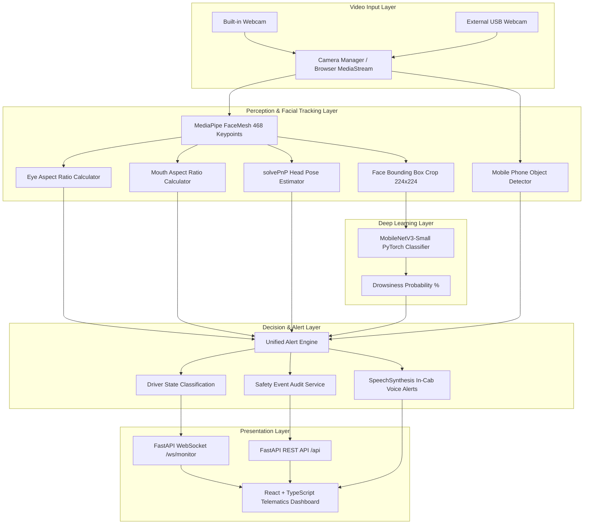

# Commercial Fleet Driver Monitoring - System Architecture

## 1. System Overview

The **Commercial Fleet Driver Drowsiness and Distraction Monitoring System** is an edge-optimized computer vision and deep learning application. It processes live video frames from integrated laptop webcams or external USB webcams, calculates geometric facial metrics (EAR, MAR, Head Pose), performs deep learning inference (MobileNetV3), and dispatches multi-tier audio warnings.

---

## 2. Component Breakdown

### 2.1 Video Ingestion & Device Switching
- **OpenCV DirectShow Backend:** Windows `CAP_DSHOW` enables rapid, non-blocking device probing across camera indices `0, 1, 2...`
- **Browser MediaStream API:** `navigator.mediaDevices.getUserMedia` allows instantaneous in-browser device switching between built-in webcams and USB video capture devices.
- **Bi-Directional WebSocket Bridge:** Live video frames can be processed either directly by backend OpenCV capture or transmitted from the browser at 20-25 FPS.

### 2.2 Computer Vision Tracking Modules
- **Face Landmark Extraction:** MediaPipe FaceMesh detects 468 3D landmarks without requiring GPU server infrastructure.
- **Eye Aspect Ratio (EAR):** Computes vertical-to-horizontal distance ratios for both eyes. Applies exponential moving average (EMA) smoothing to filter optical jitter.
- **Mouth Aspect Ratio (MAR):** Computes oral aperture ratios. Applies duration thresholding (>1.8s) to differentiate sustained yawning from normal conversation speech.
- **Head Pose Estimation:** Projects a 3D anthropometric face model onto 2D image coordinates using OpenCV's `solvePnP` iterative solver, decomposing rotation matrices into Euler angles (Yaw, Pitch, Roll).

### 2.3 Deep Learning Core (MobileNetV3-Small)
- **Architecture:** Lightweight depthwise separable convolutions with Squeeze-and-Excitation (SE) attention blocks.
- **Transfer Learning:** Pretrained ImageNet weights adapted via custom classification projection (`Dropout(0.25) -> Linear(256) -> Hardswish -> Linear(64) -> ReLU -> Linear(2)`).
- **Latency:** ~10.6ms mean inference latency on commodity CPU.

### 2.4 Alert Engine & Audio Warning Policies
- **Priority Hierarchy:**
  - **Level 3 (Critical):** Prolonged eye closure exceeding 2.5s -> Immediate urgent audible warning: *"Critical warning! Driver attention required."*
  - **Level 2 (Warning):** Prolonged eye closure (1.2s - 2.5s) or high model drowsiness (>70%) -> *"Alert! Drowsiness detected. Take a safe break."*
  - **Level 1 (Notice):** Sustained head rotation (>28° for >2.0s) or visible mobile phone interaction -> *"Warning. Please focus on the road."*
- **Cooldown Filter:** Configurable 3.5s cooldown prevents continuous alert audio spamming.
